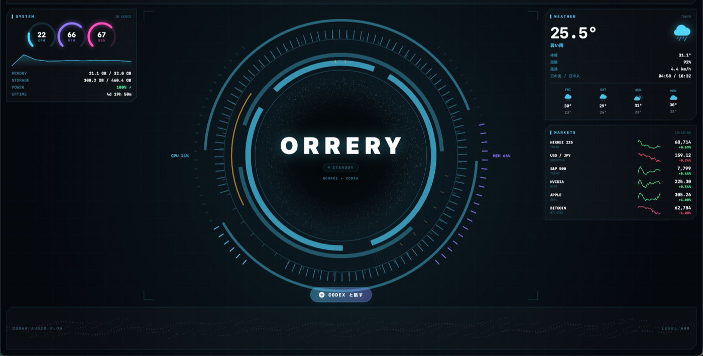
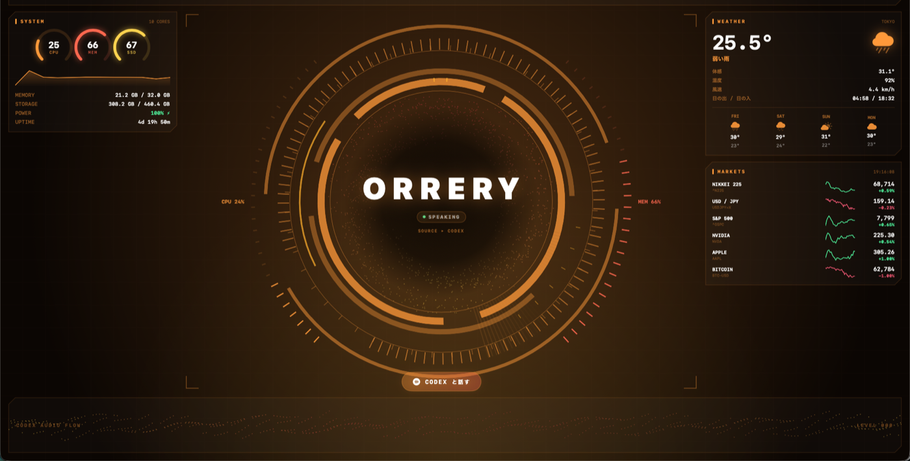
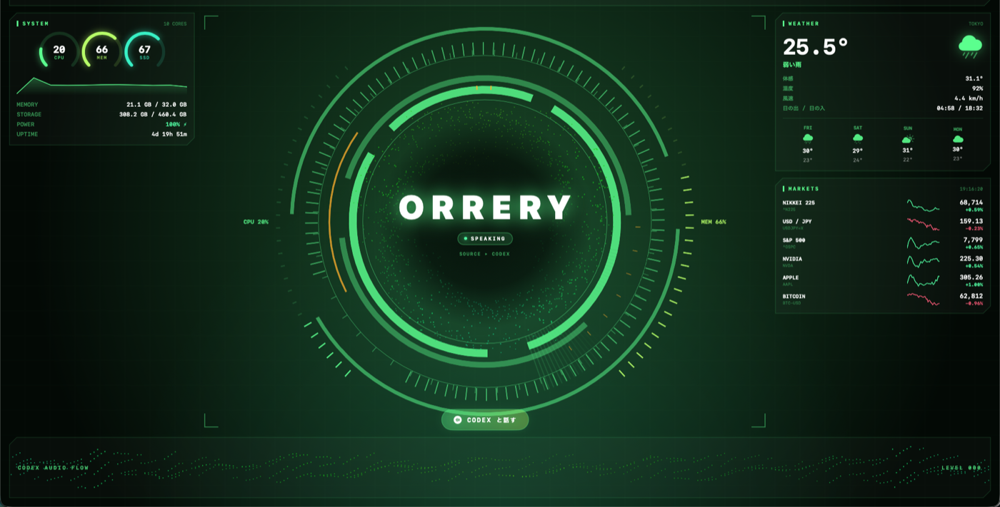

# マッスル（MUSCLE）音声起動AIエージェント


> [ito-ops/orrery](https://github.com/ito-ops/orrery)（MIT License）をもとに、
> **パソコンに話しかけるだけで Claude / Claude Code / Codex を起動できる**ように改造したものです。

## まず使い方（3ステップ）

1. Mac のターミナルで次を実行してビルド＆起動（Xcode か Command Line Tools が必要）
   ```bash
   git clone https://github.com/kearth07-spec/mac-ai-dashboard.git
   cd mac-ai-dashboard/voice-agent && ./マッスルを起動.command
   ```
2. 設定画面（⌘,）›「一般」›「起動するAI」で、起動したいAIを選ぶ
3. 上部右の「音声OFF」を押して「音声起動」にし、話しかける
   - 「**マッスル、今日のニュースを要約して**」→ マッスルが考えて、答えを画面に出して声で読み上げる
   - 「**マッスル**」だけ言って黙る → 約5秒指示を待ち、何も言わなければアプリを開くだけ
   - 「**パンパン**」と2回手を叩く → 「指示をどうぞ」と出るので、続けて話す（設定 ›「手を叩いて起動」でON/OFF・感度を変更）
   - 呼び名は設定 ›「声で起動」の「合図」で好きな名前に変えられます（例: `ジャービス,ジャーヴィス`）

### 画面を閉じても、裏でずっと聞き取る

- **⌘Q を押してもアプリは終了せず**、画面を隠して裏で声・手拍子を聞き続けます。Dock・Spotlight・メニューバーのアイコンから開くと、画面が戻ります
- 画面上部のメニューバーに **筋トレのアイコン（MUSCLE）** が出ます。ここから
  - ダッシュボードを開く／声・手拍子での起動のON/OFF
  - **Macにログインしたら自動で起動**（ONにすると、電源を入れるだけで待ち受け開始）
  - **マッスル を完全に終了**（本当に止めたいときはここから）

### ダッシュボードに出るもの

| 場所 | パネル | 内容 |
| --- | --- | --- |
| 左 | **今日のMac・AIレッスン** | リポジトリ直下の `index.html`（Mac & AI 学習ダッシュボード）のレッスンを1日1つ。◀▶で前後、「Claudeにくわしく聞く」で深掘り |
| 左 | **休憩・姿勢リマインダー** | 連続作業が50分（設定で変更可）を超えたら知らせ、デスクでできるストレッチを表示。5分さわらなければ休憩とみなす |
| 左 | システム / Claudeの使用量 | 元のORRERYと同じ（ネットワークは既定でOFF） |
| 右 | 天気 | 元のORRERYと同じ |
| 右 | **今日の予定** | Macの「カレンダー」の今日・明日の予定（Googleカレンダーも、カレンダーに追加していれば表示）。読むだけで書き換えません |
| 右 | **よく使う指示** | ワンクリックでAIに定型の指示を送るボタン。設定 › パネル で「ボタン名\|指示」を1行ずつ編集 |

株価・為替は既定でOFFです（設定 › パネル でONにできます）。`index.html` のレッスンを書き換えたら `node tools/sync-lessons.js` でアプリにも反映できます。

### 起動するAIの切り替え

| 選択肢 | 声で呼んだときの動き | 必要なもの |
| --- | --- | --- |
| **マッスルと会話**（既定） | 話した内容を Claude Code に聞き、答えを画面に出して日本語の声で読み上げる。Claude Code は開いたままにして、1文できるたびに読み上げ始めるので速い。10分以内なら会話の続きとして答える。読み上げ中に2回手を叩くと止まる。モデルと話す速さは設定で変更可 | Claudeの有料プラン（Pro/Max）でログイン済みの [Claude Code](https://docs.claude.com/en/docs/claude-code)（追加料金なし） |
| **Claudeアプリ** | Claudeデスクトップアプリを前面に出し、⌘N で新しいチャット → 話した内容を貼り付けて送信 | [Claudeデスクトップアプリ](https://claude.ai/download)、アクセシビリティの許可 |
| **Claude Code（ターミナル）** | ターミナルの新しいウィンドウで `cd 作業フォルダ && claude "話した内容"` を実行 | [Claude Code](https://docs.claude.com/en/docs/claude-code) のインストール、オートメーション（ターミナル）の許可 |
| **Codex（音声ライブ）** | 元のORRERYと同じ。Codexアプリで新しいチャット → 音声ライブを開く | Codexアプリ、アクセシビリティの許可 |

- Claude Code の作業フォルダは設定画面で選べます（既定はホーム `~`）
- 環境変数 `HUD_AGENT=claude` / `claude-code` / `codex` でも切り替えられます
- 合図に続けて話した内容は**端末内の音声認識**で文字にしてから渡します。音声そのものは保存も送信もしません
- 話し終わって約1.6秒黙ると、そこまでを指示として送ります

### 許可について（初回だけ）

| 許可 | いつ必要か |
| --- | --- |
| マイク・音声認識 | 「音声起動」を初めてONにしたとき |
| アクセシビリティ | Claudeアプリ / Codex にキー入力（⌘N・貼り付け・送信）するため |
| オートメーション › ターミナル | Claude Code を起動するため（初回に確認ダイアログが出ます） |
| 画面収録 | 中央のリングをAIの音声に反応させるため（任意） |

許可が足りないときは画面中央にメッセージと「設定を開く」ボタンが出ます。許可したら「許可したら再起動」を押してください。

---

以下は元のORRERYの説明です（「Codex」とある部分は、選んだAIに読み替えてください）。

画面いっぱいに広がるHUDダッシュボードです。中央のアークリアクターがAIの音声に反応し、まわりに日付・天気・株価・システム情報・Claudeの使用量が並びます。



配色テーマは設定画面（⌘,）から切り替えられます。

| EMBER | MATRIX |
| --- | --- |
|  |  |

## インストール

### ダウンロードして使う

> ※ここで配布されているのは元のORRERY（Codex専用）です。音声起動AIエージェント版を使うには、上の「まず使い方」の手順でソースからビルドしてください。

1. [Releases](https://github.com/ito-ops/orrery/releases/latest) から `Orrery-vX.X.X-macos.zip` をダウンロードして展開
2. `Orrery.app` を `~/Applications`（または `/Applications`）へ移動
3. 無料配布のため Apple の公証を通しておらず、初回は Gatekeeper にブロックされます。ターミナルで隔離属性を外してから開いてください:

```bash
xattr -cr ~/Applications/Orrery.app
```

（Finder で右クリック → 開く でも可。開けない場合は システム設定 › プライバシーとセキュリティ 最下部の「このまま開く」）

ソースはすべて公開されているので、気になる場合は次のソースビルドをどうぞ。

### ソースからビルドする

Xcode か Command Line Tools が入っていれば:

```bash
git clone https://github.com/ito-ops/orrery.git
```

```bash
cd orrery && ./ORRERYを起動.command
```

ビルドして `~/Applications/Orrery.app` を組み立ててから起動します。マイク・音声認識・画面収録の許可はアプリバンドル単位で記録されるため、`swift run` の素の実行ファイルでは音声機能が使えません。

終了は ⌘Q です。

### 必要な許可

| 許可 | 用途 | 求められるタイミング |
| --- | --- | --- |
| 画面収録 | Codexの音声レベルを取る（映像は保存しません） | 初回起動時 |
| アクセシビリティ | Codexへ ⌘N / ⌃⇧V を送る | 「CODEX と話す」を初めて押したとき |
| マイク・音声認識 | 声での起動 | 「音声起動」を初めてONにしたとき |

画面収録が未許可のときは中央に `SOURCE ▸ NO ACCESS` と出て、その下のボタンから設定画面を開けます。

**画面収録だけは手で追加する必要があります。** アドホック署名のアプリには macOS が自動の許可ダイアログを出さないため（`CGRequestScreenCaptureAccess()` が false を返す）、次の手順で追加してください。

1. システム設定 › プライバシーとセキュリティ › 画面収録
2. 「+」から `~/Applications/Orrery.app` を選ぶ
3. トグルをON
4. アプリを再起動

**ビルドし直すと署名（cdhash）が変わるため、この許可は外れます。** 毎回やり直すのが面倒な場合は、自己署名の証明書を作って署名を固定する方法があります。

## 音源の切り替え

上部の2つのボタンで、何の音に反応させるかを選べます。

| ボタン | 内容 |
| --- | --- |
| `CODEXのみ` / `全体の音` | Codexアプリだけの音か、システム全体の音か。Codexは内部で別プロセスが音を鳴らすため、`CODEXのみ`で拾えないことがあります |
| `自分の声` | マイクを混ぜます。**Codexと話しているときの自分の声はマイク経由**なので、これをONにしないと自分が喋っても反応しません |

システム音とマイクは、バンドごとに大きいほうを採用して合成しています。

## 画面の内容

| 場所 | 内容 |
| --- | --- |
| 左上 | 時計と日付 |
| 上部 | ホスト名 / IP / コア数 / 稼働時間、更新ボタン、重なり方の切り替え |
| 左 | CPU・メモリ・ストレージ・電源・通信量、Claudeの使用量（概算） |
| 中央 | ORRERYの文字とリング一式、CPU/メモリのセグメントゲージ、音声セッションのボタン |
| 右 | 天気（現在＋4日分の予報）、株価・為替 |
| 下部 | Codexの音に反応して流れる砂の帯 |

中央と下部の粒子は常にゆっくり流れ、Codexが喋っている間だけ色づいて大きく広がります。

## Codexの音だけを拾う

ScreenCaptureKitのフィルタを使い、Codex（`com.openai.codex`／表示名はChatGPT）とCodexBarの音だけを解析しています。対象アプリの起動・終了は6秒ごとに見張って自動で切り替わります。対象が1つも見つからないときはシステム全体の音にフォールバックし、中央に `SOURCE ▸ SYSTEM (対象なし)` と表示します。

## Codexと音声で話す

中央下の「CODEX と話す」を押すと、次の順に進みます。

1. Codexアプリ（`com.openai.codex`）を前面に出す
2. **⌘N**（`newTask`）で新しいチャットを作る
3. **⌃⇧V**（`composer.startVoiceMode`）で音声ライブを開く
4. HUDを**最前面**に切り替える

押すたびに新しいチャットから始まるので、前の会話が混ざりません。もう一度押すと元の重なり方に戻り、Codexアプリが前面に戻ります。

他アプリへキーを送るので、**システム設定 › プライバシーとセキュリティ › アクセシビリティ** でこのアプリの許可が必要です。初回は許可ダイアログが出ます。ビルドし直すと署名が変わるため、許可を求め直される場合があります。許可していない場合もアプリを前面に出すところまでは動くので、続きは Codex 側で ⌘N → ⌃⇧V を押してください。

## 声で起動する

上部右の「音声OFF」を押すと待ち受けが始まり、決めた言葉を聞き取るとボタンを押したのと同じ動作をします。

- 既定の合図: `マッスル` / `muscle`
- Claude系を選んでいるときは、合図に続けて話した内容がそのまま指示になります
- 認識は**端末内だけ**（`requiresOnDeviceRecognition`）で行い、音声は保存も送信もしません
- セッション中は反応しません（Codexの声で誤って起動しないため）。一度反応すると6秒は次を受け付けません
- 聞き取れた文は上部に小さく出るので、反応しないときの手がかりになります
- 設定は記憶されるので、一度ONにすれば次の起動でも待ち受けます

初回のONで**マイク**と**音声認識**の許可を求められます。

## ウィンドウの扱い

ふつうのアプリと同じように扱えます。

| 操作 | 方法 |
| --- | --- |
| 移動 | 画面のどこでもドラッグ（タイトルバーが無いので背景でつかめます） |
| リサイズ | 端をドラッグ。最小 900×600 |
| 画面いっぱいに戻す | ⌘0 |
| 中央に小さく置く | ⌘9 |
| 最小化 / 閉じる / 終了 | ⌘M / ⌘W / ⌘Q |
| 重なり方の切り替え | ⌘T か上部右のボタン |

Mission Control、App Exposé、ウィンドウの整列（タイル表示）にも出ます。位置とサイズは次回起動時に復元されます。

## 重なり方

上部右のボタン（または ⌘T）で3段階に切り替わります。

| モード | 重なり | 移動 | Mission Control |
| --- | --- | --- | --- |
| **通常** | ふつうのウィンドウ | できる | 出る |
| **最前面** | 常に手前、全スペースに表示 | できる | 出る |
| **デスクトップ** | 壁紙の上・ウィンドウの後ろ | できない | 出ない |

## 設定画面

⌘,（または上部右の「設定」ボタン）で設定画面が開きます。設定は保存され、次回起動にも引き継がれます。

| タブ | 内容 |
| --- | --- |
| 一般 | 天気の地点、株価・為替の銘柄、声で起動する合図 |
| テーマ | 配色5種（ARC / EMBER / MATRIX / CRIMSON / MONO）＋カスタムカラー。1色選ぶと残りは自動で組み立てます |
| パネル | 各パネルと下部の砂の帯を個別にON/OFF。列ごと消すと中央が広がります |
| 負荷 | 粒子の数、更新頻度 |

## 環境変数

すべて設定画面から変えられますが、環境変数でも上書きできます。優先順は **環境変数 > 設定画面 > 既定値** です。

| 変数 | 既定値 | 内容 |
| --- | --- | --- |
| `HUD_CITY` | `TOKYO` | 天気パネルに出す地名 |
| `HUD_LAT` / `HUD_LON` | 東京の緯度経度 | 天気を取る地点 |
| `HUD_TICKERS` | 日経・ドル円など6銘柄 | 株価パネルの銘柄。「シンボル:表示名」をカンマ区切りで（例 `^N225:NIKKEI 225,BTC-USD:BITCOIN`） |
| `HUD_AGENT` | `claude` | 起動するAI（`claude` / `claude-code` / `codex`） |
| `HUD_CLAUDE_CODE_DIR` | `~` | Claude Code を起動するフォルダ |
| `HUD_AUDIO_APPS` | 起動するAIに合わせる（`claude` か `codex`） | 音を拾う対象アプリ（アプリ名かバンドルIDの一部、カンマ区切り） |
| `HUD_WAKE_PHRASES` | `マッスル,マッスー,muscle` | 声で起動するときの合図（カンマ区切り） |
| `HUD_WAKE_LOCALE` | `ja-JP` | 音声認識の言語 |
| `HUD_GRAINS` | `1100` | 粒子の数（0で粒子なし） |
| `HUD_FPS` / `HUD_IDLE_FPS` | `30` / `12` | 音が出ている間 / 待機中の更新頻度 |
| `HUD_STATIC` | `0` | `1` で動く描画を止める（いちばん軽い） |
| `HUD_WINDOW` | なし | `1200x800` のように初期サイズを指定 |

例:

```bash
HUD_CITY=OSAKA HUD_LAT=34.6937 HUD_LON=135.5023 swift run
```

## 負荷について

全画面のCanvasを描き続けるので、待機中でCPUの約25〜30%（1コアぶん）を使います。10コアの機械なら全体の3%程度ですが、気になる場合は次で下げられます。

| やり方 | 効果 |
| --- | --- |
| ウィンドウを小さくする（⌘9） | 見た目の負担が減る |
| `HUD_STATIC=1` で起動 | 約7%まで下がる（粒子もリングも止まります） |
| 「音声起動」をOFF | 音声認識のぶんが減る |

計測したところ、粒子の数・フレームレート・ウィンドウサイズを変えても消費はほぼ変わらず、**SwiftUIのCanvasを再描画すること自体**が固定費でした。さらに下げるには描画をAppKit側（CoreGraphics）に移す必要があります。

## データの出どころ

- 天気: [Open-Meteo](https://open-meteo.com)（APIキー不要）
- 株価・為替: Yahoo Finance のチャートAPI（APIキー不要）
- システム情報: mach / IOKit / getifaddrs
- Claudeの使用量: `~/.claude/projects` のログ。usage・timestamp・model・requestId だけを読み、会話の本文は読みません

セッションを再開・分岐すると過去のやり取りが新しいログへ丸ごとコピーされるため、単純に足すと実際の2.5倍ほどになります。`requestId` でファイルをまたいだ重複を落としてから集計しています。

金額はモデル名から推定した単価による**概算**です。とくに `claude-fable-5` は公開単価を確認できなかったため仮の値で、実際の請求額とは一致しません。単価は `UsageService.swift` の `rate(for:)` にまとめてあります。

## 構成

| ファイル | 役割 |
| --- | --- |
| `App.swift` | ウィンドウの設定・重なり方・メニュー |
| `HUDView.swift` | 全体のレイアウトと上部バー |
| `HUDSettings.swift` | 設定画面の項目と保存（UserDefaults） |
| `HUDTheme.swift` | 配色テーマの定義とカスタムカラーの組み立て |
| `SettingsView.swift` | 設定画面（⌘,）のUI |
| `OrreryDial.swift` | 中央のリング一式 |
| `ParticleField.swift` | 粒子の配色と下部の砂の帯 |
| `CenterStage.swift` | 時計とCodexボタン |
| `HUDPanels.swift` | 各パネル |
| `HUDComponents.swift` | 共通の部品と配色 |
| `AudioSpectrum.swift` | 音声キャプチャと状態管理 |
| `WakeWordListener.swift` | 声での起動（端末内の音声認識） |
| `AgentLauncher.swift` | 選んだAI（Claudeアプリ / Claude Code / Codex）を立ち上げ、話した指示を渡す |
| `SpectrumAnalyzer.swift` | FFT |
| `SystemMonitor.swift` / `WeatherService.swift` / `MarketService.swift` / `UsageService.swift` | 各データの取得 |
| `AppResources/Info.plist` | バンドルのInfo.plist（用途説明・アイコン指定） |
| `AppResources/Orrery.icns` | アプリアイコン |
| `tools/make-icon.swift` | アイコンを描き直すスクリプト |

見た目や反応の速さは `AudioSpectrum.swift` の `Tuning`、半径のバランスは `OrreryDial.swift` の `R` で調整できます。
